# Nashua review sheet

Strips of the whole reach (2458.8 m, 4917.6 world px, plus 24 px of paper at each end), rendered by the app in one viewport as wide as the reach. Made with `node tools/nashua/review.mjs`. Palette nashua-kit, seed 1, Vertical Exaggeration 10x, dry, fog 0.25. Day: light 1. Night: light 0, lights on. Pack hash 2cd2b856a894206a.

Left bank: downstream to the right. Right bank: downstream to the left (the mirror).

| Strip | px | Bank | Light | Water level | Labels | KB |
| --- | --- | --- | --- | --- | --- | --- |
| [nashua_720p_bank-L_day_level-0.jpg](nashua_720p_bank-L_day_level-0.jpg) | 5104 x 720 | left bank | day | Median Water 28.30 m (92.8 ft) | off | 338 |
| [nashua_720p_bank-L_day_level-2.jpg](nashua_720p_bank-L_day_level-2.jpg) | 5104 x 720 | left bank | day | Fluvial · Minor Flood 32.01 m (105.0 ft) | off | 390 |
| [nashua_720p_bank-L_day_level-4.jpg](nashua_720p_bank-L_day_level-4.jpg) | 5104 x 720 | left bank | day | Fluvial · 1936 Flood of Record 39.09 m (128.26 ft) | off | 298 |
| [nashua_720p_bank-L_night_level-0.jpg](nashua_720p_bank-L_night_level-0.jpg) | 5104 x 720 | left bank | night | Median Water 28.30 m (92.8 ft) | off | 210 |
| [nashua_720p_bank-L_night_level-2.jpg](nashua_720p_bank-L_night_level-2.jpg) | 5104 x 720 | left bank | night | Fluvial · Minor Flood 32.01 m (105.0 ft) | off | 244 |
| [nashua_720p_bank-L_night_level-4.jpg](nashua_720p_bank-L_night_level-4.jpg) | 5104 x 720 | left bank | night | Fluvial · 1936 Flood of Record 39.09 m (128.26 ft) | off | 181 |
| [nashua_720p_bank-R_day_level-0.jpg](nashua_720p_bank-R_day_level-0.jpg) | 5104 x 720 | right bank | day | Median Water 28.30 m (92.8 ft) | off | 338 |
| [nashua_720p_bank-R_day_level-2.jpg](nashua_720p_bank-R_day_level-2.jpg) | 5104 x 720 | right bank | day | Fluvial · Minor Flood 32.01 m (105.0 ft) | off | 374 |
| [nashua_720p_bank-R_day_level-4.jpg](nashua_720p_bank-R_day_level-4.jpg) | 5104 x 720 | right bank | day | Fluvial · 1936 Flood of Record 39.09 m (128.26 ft) | off | 320 |
| [nashua_720p_bank-R_night_level-0.jpg](nashua_720p_bank-R_night_level-0.jpg) | 5104 x 720 | right bank | night | Median Water 28.30 m (92.8 ft) | off | 211 |
| [nashua_720p_bank-R_night_level-2.jpg](nashua_720p_bank-R_night_level-2.jpg) | 5104 x 720 | right bank | night | Fluvial · Minor Flood 32.01 m (105.0 ft) | off | 235 |
| [nashua_720p_bank-R_night_level-4.jpg](nashua_720p_bank-R_night_level-4.jpg) | 5104 x 720 | right bank | night | Fluvial · 1936 Flood of Record 39.09 m (128.26 ft) | off | 199 |
| [nashua_720p_bank-L_day_level-0_labels.jpg](nashua_720p_bank-L_day_level-0_labels.jpg) | 5104 x 720 | left bank | day | Median Water 28.30 m (92.8 ft) | on | 350 |
| [nashua_720p_bank-R_day_level-0_labels.jpg](nashua_720p_bank-R_day_level-0_labels.jpg) | 5104 x 720 | right bank | day | Median Water 28.30 m (92.8 ft) | on | 346 |
| [nashua_1080p_bank-L_day_level-0.jpg](nashua_1080p_bank-L_day_level-0.jpg) | 7656 x 1080 | left bank | day | Median Water 28.30 m (92.8 ft) | off | 752 |
| [nashua_1080p_bank-L_night_level-3.jpg](nashua_1080p_bank-L_night_level-3.jpg) | 7656 x 1080 | left bank | night | Fluvial · 1% Annual Chance Flood (FEMA) 34.63 m (113.6 ft) | off | 524 |
| [nashua_1080p_bank-R_day_level-0.jpg](nashua_1080p_bank-R_day_level-0.jpg) | 7656 x 1080 | right bank | day | Median Water 28.30 m (92.8 ft) | off | 752 |
| [nashua_1080p_bank-R_night_level-3.jpg](nashua_1080p_bank-R_night_level-3.jpg) | 7656 x 1080 | right bank | night | Fluvial · 1% Annual Chance Flood (FEMA) 34.63 m (113.6 ft) | off | 516 |

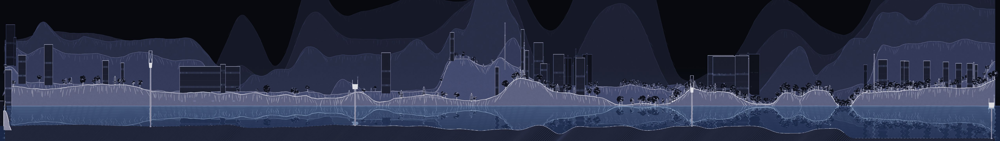

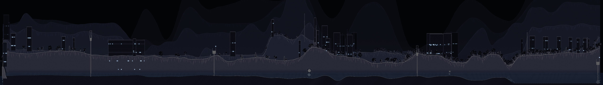

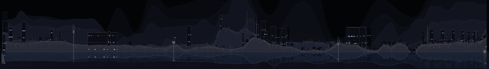

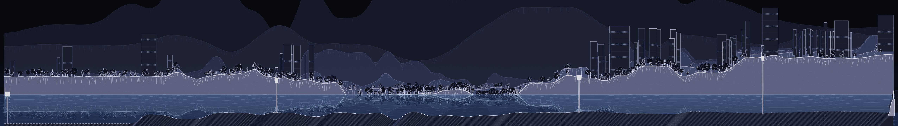

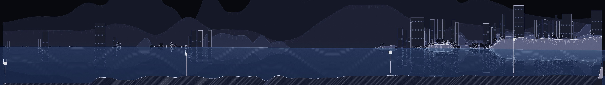

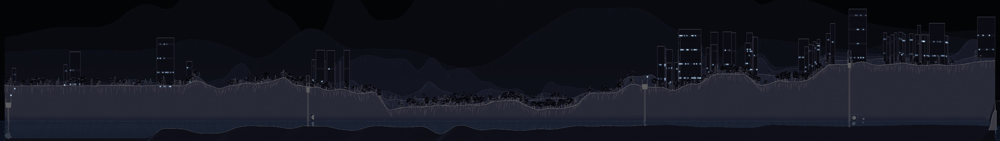

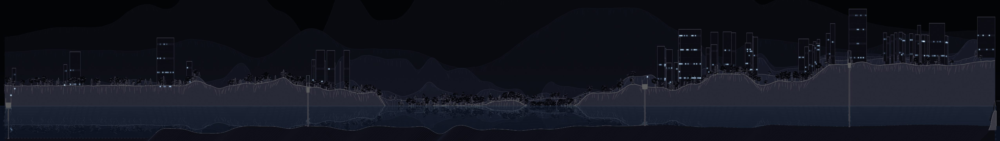

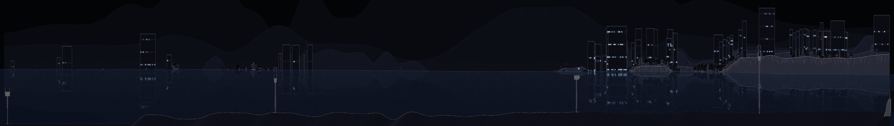

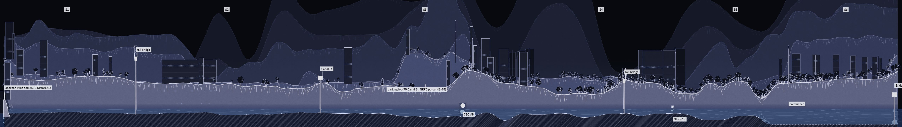

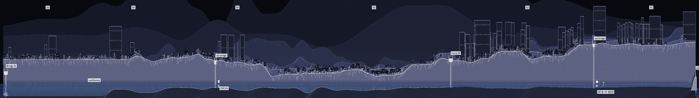

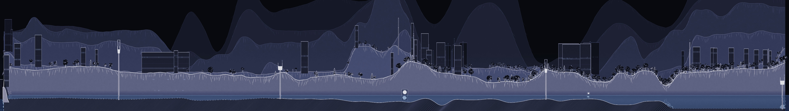

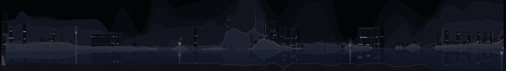

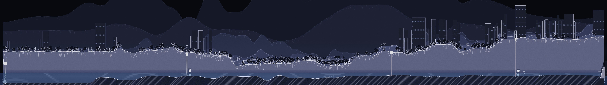

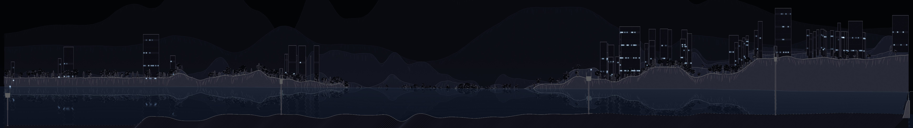

<!-- p5 strips: made by tools/nashua/review-p5.mjs -->
## P5 strips

Made with `node tools/nashua/review-p5.mjs`, the same way as the strips above (seed 1, nashua-kit, Vertical Exaggeration 10x, dry, fog 0.25, 720 px high, the whole reach in one viewport). "Lit" is the share of pixels brighter than 110 of 255 (luma), so the day and the night strips can be compared by one number.

| Strip | px | What | Pack | Lit | KB |
| --- | --- | --- | --- | --- | --- |
| [nashua_720p_bank-L_daycycle-2200_level-0.jpg](nashua_720p_bank-L_daycycle-2200_level-0.jpg) | 5104 x 720 | Nashua, left bank, day cycle at 22:00 EST on 2024-07-01, Median Water | 2cd2b856a894206a, 2458.8 m | 0.0007 | 213 |
| [nashua_720p_bank-L_daycycle-1200_level-0.jpg](nashua_720p_bank-L_daycycle-1200_level-0.jpg) | 5104 x 720 | Nashua, left bank, day cycle at 12:00 EST on 2024-07-01, Median Water | 2cd2b856a894206a, 2458.8 m | 0.0323 | 338 |
| [merrimack_720p_bank-L_day_level-0.jpg](merrimack_720p_bank-L_day_level-0.jpg) | 10344 x 720 | Merrimack, left bank, day, Median Water | cec345b089d01283, 5008 m | 0.0341 | 719 |
| [merrimack_720p_bank-L_night_level-0.jpg](merrimack_720p_bank-L_night_level-0.jpg) | 10344 x 720 | Merrimack, left bank, night, Median Water | cec345b089d01283, 5008 m | 0.0004 | 431 |
| [merrimack_720p_bank-R_day_level-2.jpg](merrimack_720p_bank-R_day_level-2.jpg) | 10344 x 720 | Merrimack, right bank, day, level 2 | cec345b089d01283, 5008 m | 0.0372 | 746 |
| [nashua_720p_bank-L_day_level-0_ticks.jpg](nashua_720p_bank-L_day_level-0_ticks.jpg) | 5104 x 720 | Nashua, left bank, day, `?ticks=1` (a tick every 100 m, a label every 500 m) | 2cd2b856a894206a, 2458.8 m | 0.0357 | 344 |
| [output_720p_nashua_day.jpg](output_720p_nashua_day.jpg) | 5104 x 720 | Output window, Nashua, day, no cap | output | 0.0316 | 338 |
| [output_720p_nashua_day_cap-60.jpg](output_720p_nashua_day_cap-60.jpg) | 5104 x 720 | Output window, Nashua, day, `&cap=0.6` | output | 0.0054 | 253 |
| [hydrograph_1936-03-19.png](hydrograph_1936-03-19.png) | 480 x 133 | `?hydro=1` at 1936-03-19 (the hydrograph only, 480 x 132 css px) | controller | 0.0772 | 16 |

The Merrimack reach: 5008 m below the confluence, from the same DEM, land cover and footprints as the Nashua, by `tools/nashua/build-reach.py`. No measured bed (the proxy only), no dam, lot, stations or outfalls in it, and its water levels are the Nashua's carried unchanged (the fact line says so).

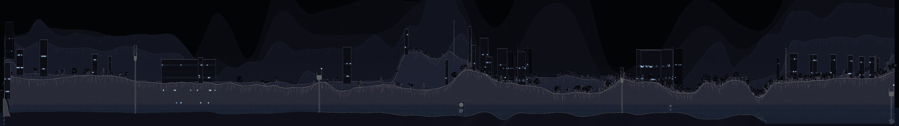

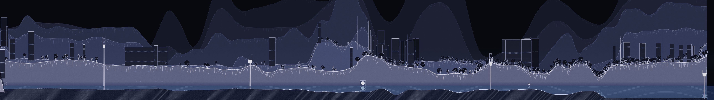

<!-- end p5 strips -->

<!-- p6 strips: made by tools/nashua/review-p6.mjs -->
## P6 strips: before and after

Made with `node tools/nashua/review-p6.mjs`. Seed 1, nashua-kit, left bank (the north bank, downstream to the right), day, Median Water, dry, fog 0.25, labels off, 360 px high, the whole reach plus 24 world px of paper at each end. Before: the `.p5` tag, with the filled hills, 2 world px per m, Vertical Exaggeration 10x. After: P6 at its defaults, no filled hills (one thin ridgeline of real ground, the near bank, the buildings in rows by distance), 8 world px per m, Vertical Exaggeration 2x. The after strips are four times as long because the horizontal scale is four times larger; the heights are one fifth because the exaggeration is one fifth. Building heights are estimated.

| Strip | px | Reach | When | Scale | Pack | KB |
| --- | --- | --- | --- | --- | --- | --- |
| [p6_nashua_360p_bank-L_day_level-0_before.jpg](p6_nashua_360p_bank-L_day_level-0_before.jpg) | 2552 x 360 | Nashua, 2458.8 m | before | 2 px per m, 10x | 2cd2b856a894206a | 91 |
| [p6_nashua_360p_bank-L_day_level-0_after.jpg](p6_nashua_360p_bank-L_day_level-0_after.jpg) | 10134 x 360 | Nashua, 2458.8 m | after | 8 px per m, 2x | 6f84a65ea6634724 | 232 |
| [p6_merrimack_360p_bank-L_day_level-0_before.jpg](p6_merrimack_360p_bank-L_day_level-0_before.jpg) | 5172 x 360 | Merrimack, 5008 m | before | 2 px per m, 10x | cec345b089d01283 | 195 |
| [p6_merrimack_360p_bank-L_day_level-0_after.jpg](p6_merrimack_360p_bank-L_day_level-0_after.jpg) | 20614 x 360 | Merrimack, 5008 m | after | 8 px per m, 2x | d6e8e688ca0912da | 540 |

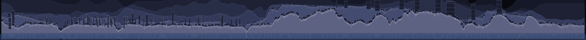

The controller at s 1110 m (the church behind the lot), labels on, the map inset on at its default size (400 px): north up, the stations, the dot at the playhead.

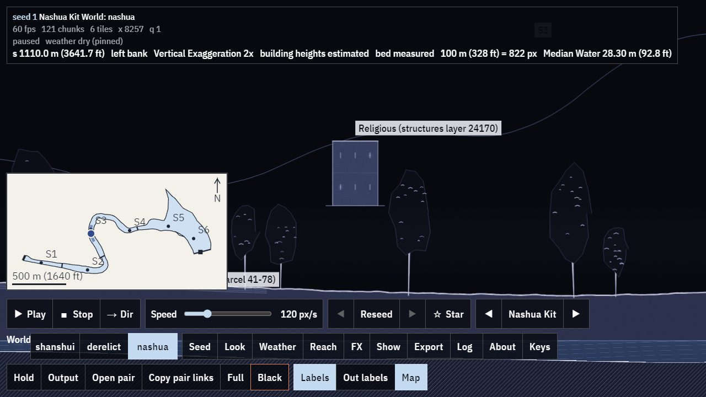

<!-- end p6 strips -->
